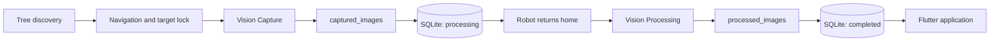

# FYP Durian Inspection System

Autonomous durian-tree inspection using **ROS 2 Humble**, **Gazebo**, RGB-D
vision, selectable detector backends, SQLite, and a Flutter monitoring app.

## Final FYP release status

The completed deployment-oriented study contains six trained models. Run07 and
Run08 were cancelled before training and are not represented as completed
experiments. The frozen primary scientific selection remains **Run01**, while
**Run04 YOLO26n-P2 V4.2 corrected Hybrid** is the engineering winner and the
active ROS2 production model after exact-checkpoint CUDA/Gazebo verification.

| Production field | Frozen value |
|---|---|
| Backend | `fyp_run04_v42` |
| Checkpoint SHA-256 | `04fa8dc9fa7df9bb238ab42469dee857caedb1c36d2d02bdf252bb9e831bc6f5` |
| Active config SHA-256 | `f2d159baeaa135c536b552e2919106fafd455f4f91ee7807ce21d4c27dd9e9c4` |
| Detection threshold | `0.45` |
| Device policy | `cuda_required` |
| Classes | six canonical leaf-condition classes |
| Run01 rollback | snapshot 8/8 verified; CUDA load drill PASS |

The checkpoints remain SHA-bound artifacts in
[`JohnyChia/durian_training`](https://github.com/JohnyChia/durian_training/tree/model-synthetic-and-hybrid/models_8run)
at commit `d673a31b09543fb4e7aca4bb10bb22b6bfc76bd1`; they are not duplicated in
this repository. See the [final release index](docs/releases/fyp-final-20261018/README.md)
for the evidence chain, model identities, recovery requirements, and declared
limitations.

The robot discovers and visits each tree, captures synchronized RGB-D evidence,
returns home, processes the saved observations, and publishes a final disease
result for the Flutter application.

## Project tasks

- Discover durian trees and navigate to each target safely.
- Capture synchronized RGB, depth, camera calibration, and TF data.
- Detect trees and fruit and classify six durian leaf conditions.
- Store raw observations and processed images by inspection and tree ID.
- Record disease, coverage, confidence, priority, and remedy in SQLite.
- Show each tree as `processing` or `completed` in the Flutter application.

## System pipeline



### Vision Capture

`vision_node.py` performs lightweight online capture only:

```text
RGB + Depth + Camera Info
            |
            v
      RGB-D synchronization
            |
            v
  Save RGB + Depth + TF + metadata
            |
            v
captured_observations.status = CAPTURED
```

### Vision Processing

`processing_node.py` performs deferred inference after the robot returns home:

```text
Load captured observations
            |
            v
Tree YOLO -> Distance -> Target association -> Tree ROI
                                      |             |
                                      v             v
                               Fruit detection  Disease detection
                                      \             /
                                       Result aggregation
                                                |
                                                v
                                      status = completed
```

## Repository structure

```text
durian_ws/
├── models/leaf_candidates/       # Local checkpoints + lightweight manifests
├── runtime/                      # Backend setup and verification tools
├── scripts/                      # Development-safe test/validation helpers
├── src/
│   ├── durian_inspection_pkg/    # ROS 2 inspection package
│   │   ├── inspection_server.py  # Navigation and inspection controller
│   │   ├── vision_node.py        # RGB-D capture pipeline
│   │   ├── processing_node.py    # Deferred inference pipeline
│   │   ├── observation_store.py  # SQLite schema and migrations
│   │   ├── bridge_node.py        # ROS-to-UI bridge
│   │   └── map_publisher.py      # Stored map publisher
│   └── durian_message/           # Custom ROS interfaces
├── durian_flutter_app/           # Flutter monitoring application
├── validate_fyp_development.sh   # Sealed-test-safe readiness validator
├── run.sh                        # Build and launch script
└── README.md
```

## Leaf detector backends

The backend-neutral worker supports `yolo26n`, `yolo26n_p2`, `rfdetr_n`, and
`dfine_n`. It normalizes class IDs, confidence, and XYXY boxes before returning
results to ROS. Framework dependencies are isolated from the ROS environment.

Backend, checkpoint, thresholds, runtime and class identity are selected by a
validated deployment YAML. A different validated file can be supplied without
editing ROS source:

```bash
ros2 launch durian_inspection_pkg navigation_launch.py \
  leaf_deployment_config:=/absolute/path/to/leaf_detector_deployment.yaml
```

The checkpoints classify six conditions:

- Algal Spot
- Blight
- Colletotrichum / Anthracnose
- Healthy
- Phomopsis
- Rhizoctonia

## Final model-selection methodology

All six checkpoints were evaluated through the same frozen prediction
contract. Thresholds were selected only on the permitted common Synthetic Val
cohort; Synthetic/Gazebo Dev and the frozen 58-image AI-assisted real reference
were scored without retuning. The sealed test was not accessed.

Run04 led Synthetic/Gazebo Dev at mAP50-95 `0.5613` and scored `0.2409` on the
AI-assisted real reference. Run02 led that real reference at `0.2454`, a small
difference on a non-expert, 58-image supporting cohort. Under the frozen
Synthetic/Gazebo-first engineering policy, Run04 remained the recommended
candidate and then passed the exact-SHA CUDA ROS2/Gazebo deployment gates.
Run06 was excluded by hard-gate failures; it was never silently promoted.

The scientific and engineering conclusions are deliberately separate:

- **Primary scientific selection:** Run01, preserving the original frozen
  synthetic-control scope.
- **Engineering selection and active deployment:** Run04 V4.2 corrected Hybrid.
- **Rollback deployment:** Run01, with a hash-verified recovery snapshot.

## Requirements

- Ubuntu 22.04
- ROS 2 Humble
- Gazebo Classic and `gazebo_ros`
- Navigation2 and TF2
- Python 3, OpenCV, NumPy, PyTorch, and Ultralytics
- Git LFS
- Flutter SDK for the monitoring application

## Clone

Historical intentionally tracked checkpoints use Git LFS. Current candidate
checkpoints and formal experiment assets are local-only and are not distributed
by this public repository.

```bash
sudo apt-get update
sudo apt-get install -y git-lfs
git lfs install

git clone https://github.com/JohnyChia/fyp.git
cd fyp
git lfs pull
```

## Build and run

```bash
chmod +x run.sh
./run.sh
```

Manual launch:

```bash
colcon build --symlink-install
source install/setup.bash
source /usr/share/gazebo/setup.sh
ros2 launch durian_inspection_pkg navigation_launch.py
```

## Development validation

```bash
./validate_fyp_development.sh
PYTEST_DISABLE_PLUGIN_AUTOLOAD=1 python3 -m pytest -q \
  src/durian_inspection_pkg/test
```

Current software status is `FINAL_FYP_RELEASE`. Six-model comparison,
Run04 exact-checkpoint CUDA/Gazebo E2E verification, controlled production
promotion, Run01 rollback verification, and the controlled GitHub release gate
are complete. The release commit identity is authoritative in Git history.

## Runtime outputs

| Output | Description |
|---|---|
| `captured_images/<inspection>/<tree>/` | RGB, depth, and metadata evidence |
| `processed_images/<inspection>/<tree>/` | Annotated inference results |
| `durian_inspection.db` | Observations and final tree results |

Runtime outputs, build products, databases, runtime environments, datasets,
formal packages and local checkpoints are ignored by Git and must remain local:

```text
experiment/
hybrid_datasets/
external_datasets/
runtime/leaf_backend_deps/
runtime/leaf_backend_sources/
models/leaf_candidates/*_best.pt
models/leaf_candidates/*_best.pth
```

## Reproducibility boundaries

- V4.2 repaired Hybrid source-family leakage and is bound to correction
  manifest SHA-256
  `b634760affc11ce33f4dcbda5904aa4c482480824a3650b2d70b9add45a062bd`.
- V4.1 synthetic-only and V4.2 corrected-Hybrid runs are useful for deployment
  engineering, but they are not a clean same-dataset causal estimate of the
  Hybrid-training effect.
- The 58-image real reference is AI-assisted FYP evidence, not independent
  expert ground truth. No sealed-test performance claim is made.
- CUDA/Gazebo release verification applies to the tested NVIDIA GeForce RTX
  3050 Ti Laptop GPU workstation. Other hardware requires fresh deployment
  verification without retuning.
- The active production profile intentionally references the external
  `durian_training` checkout by absolute path. Restore that checkout and verify
  its SHA-bound checkpoint before launching on a recovered workstation.

## Tree status

```text
processing  -- successful durable result -->  completed
```

If processing fails, the error is stored in `processing_error` and the tree
remains `processing`. It is never incorrectly labelled `completed`.
